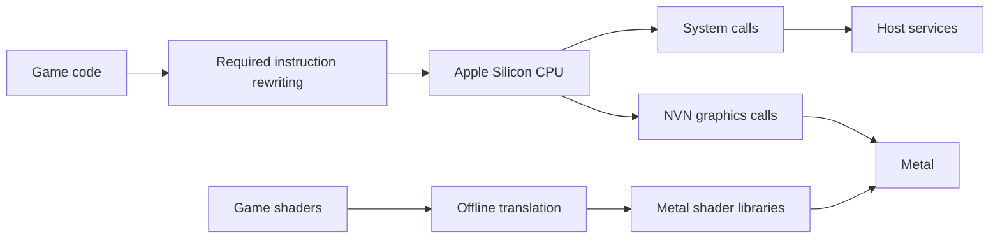

# smbw-mobile

An experimental adaptation of Super Mario Bros. Wonder for Apple platforms.

This project is based on [D2R Mobile](https://github.com/d2r-mobile/d2r-mobile), retaining its native execution, host services and Metal framework while adding resource-pool and shared-texture reclamation, along with macOS graphics and input adaptations.


<details>
<summary>More screenshots</summary>


</details>

## Overview

Testing has so far been limited to a MacBook Pro (M5 Pro, 48 GB RAM, macOS 27.0). The project retains the foundations for ports to other Apple Silicon Macs and iPhone/iPad, but operation on these devices has not been verified. Feedback with device information and test results, as well as improvements submitted through pull requests, is welcome.

## Performance


| Metric | Measured result |
| --- | --- |
| Submission-thread CPU time | p50 / p95 / p99: **4.153 / 5.988 / 6.660 ms** |
| Summed GPU execution time | p50 / p95 / p99: **4.545 / 8.864 / 9.447 ms** |
| Process memory footprint | Peak **3094 MiB**; final **3023 MiB** |
| Metal allocation | Peak **1862 MiB**; final **1846 MiB** |
| Shared texture cache | Final **643 MiB** |

### Optimization comparison


## Technical details

Game code executes natively on the Apple Silicon CPU, with system calls and graphics calls connected to Apple platform APIs through the host:



- **Native execution**: only instructions required for platform adaptation are rewritten. Handling that depends on fixed module addresses is enabled by NSO build ID.
- **Memory reclamation**: storage caches are cleared when memory pools are destroyed. Content still used by descriptors is retained until the last slot is overwritten or unregistered. Descriptor pools are managed independently by generation; textures and buffers are retired using GPU fences, and temporary references created during submission and residency registration or removal are drained promptly.
- **Temporary storage and page mapping**: temporary space is reused according to command lifetimes to avoid overwriting data still in use. The game uses 4 KiB pages and the host uses 16 KiB pages; unmapping reclaims only whole host pages fully contained within the unmapped range, preserving partially covered edge pages.
- **Graphics adaptation**: a separate copy is used when a render target is also sampled. Command data that may be reused prematurely is snapshotted on submission. Shaders are translated offline, then loaded and prewarmed at runtime.
- **Audio and input**: audio and input are connected through Apple platform APIs, with handling for window focus changes.
- **Controller vibration**: the default GameController and Core Haptics path approximates intensity on the controller's supported channels. An optional [native Switch 2 Pro BLE path](docs/ns2-pro-haptics.zh-CN.md) preserves independent dual-band commands, verified with physical controller probes and gameplay. Initial feedback reported finer but weak vibration; the revised gain and player-light behavior still need physical confirmation. Absolute force is not console-calibrated. Both paths handle focus loss, disconnection and exit.

## Build and launch

An Apple Silicon Mac, Xcode 27, .NET 10, Python and SPIRV-Cross are required. Provide your own legally obtained base game 1.0.0, update 1.2.1 and required keys; this repository neither distributes these files nor provides download sources. Follow the [macOS build steps](docs/build-macos.zh-CN.md) to extract the files, rewrite instructions, and build the shaders and host, then launch from the repository root:

```sh
bash scripts/run-mac.sh
```

The default workspace is `smbw-mac-work/`, next to the repository; use `SMBW_WORKSPACE` to specify a custom location. Within the workspace, `run/save/` stores saves and `run/manual.log` stores the launch log. Game files, keys and generated caches all remain outside the repository.

Run `bash scripts/package-mac.sh` to generate a local launcher `.app`. It references absolute workspace paths and is not a standalone distributable game package.

### Controls

Keyboard and compatible physical controllers are supported. Keyboard mappings:

| Keyboard | Game input |
| --- | --- |
| W / A / S / D | Left stick |
| Arrow keys | D-pad |
| J / K / U / I | A / B / X / Y |
| Q / E; Z / C | L / R; ZL / ZR |
| F / G | Left / right stick click |
| Enter / Tab | + / − |

### Known issues

- Not all courses have been tested; the shared texture cache grows over time
- Encountering a new rendering pipeline for the first time may cause compilation stutter; subsequent runs can reuse the cache
- Operation on other devices (such as iPad) has not been verified


## License

The project code retains the [MIT License](LICENSE) and upstream copyright notices. Third-party components follow their respective licenses; see [docs/licenses](docs/licenses) and the individual component directories for notices. Rights to game files and associated trademarks belong to their respective owners. This project does not distribute game files or keys.
