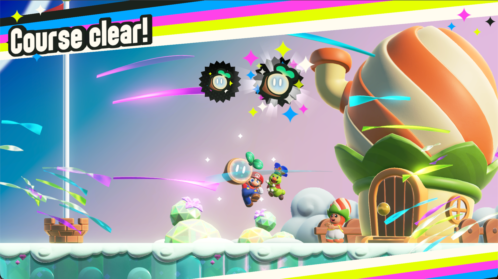
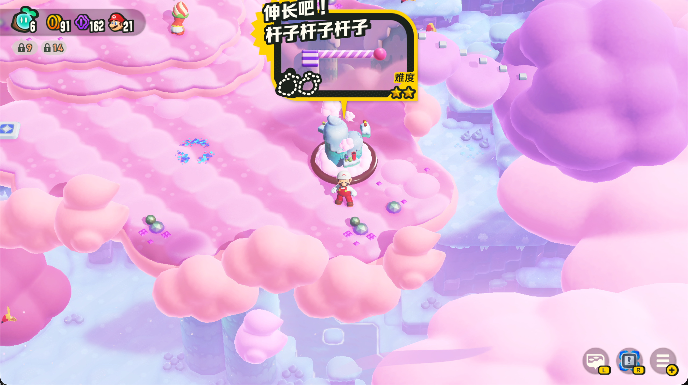
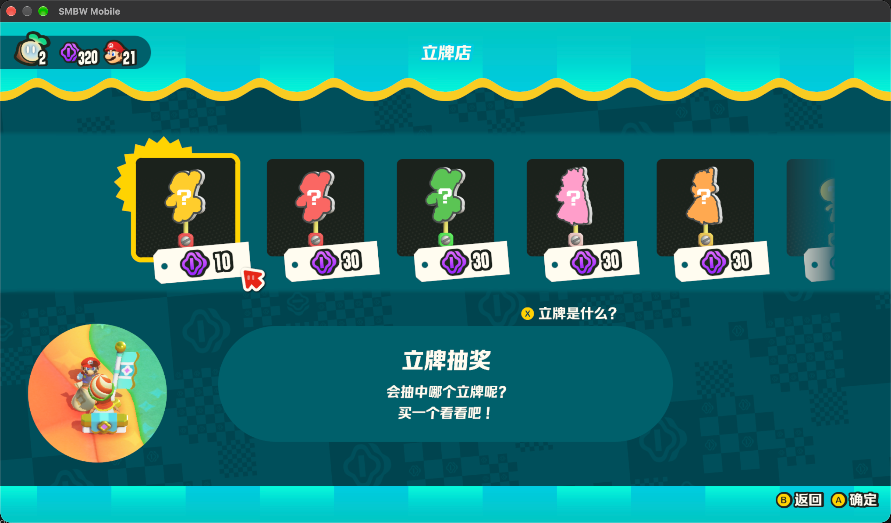
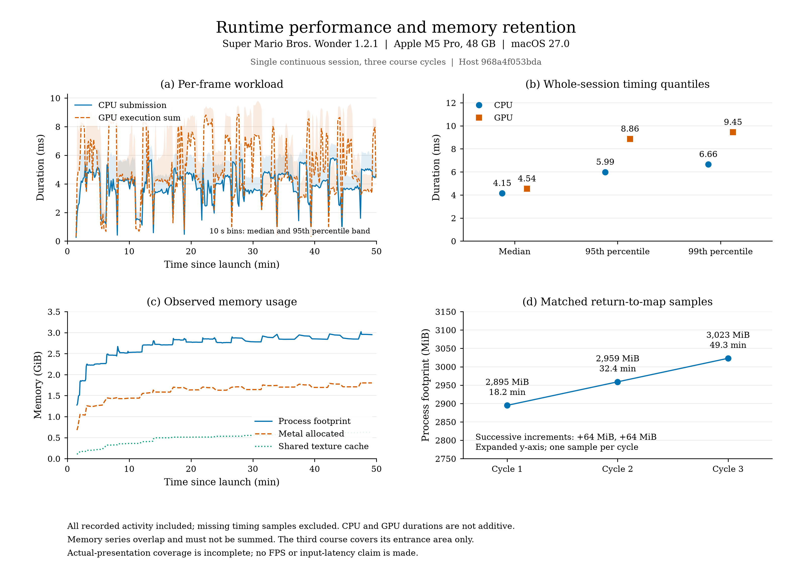
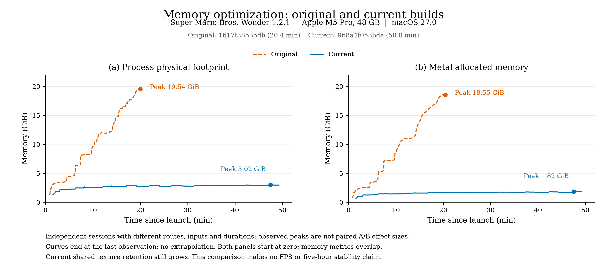
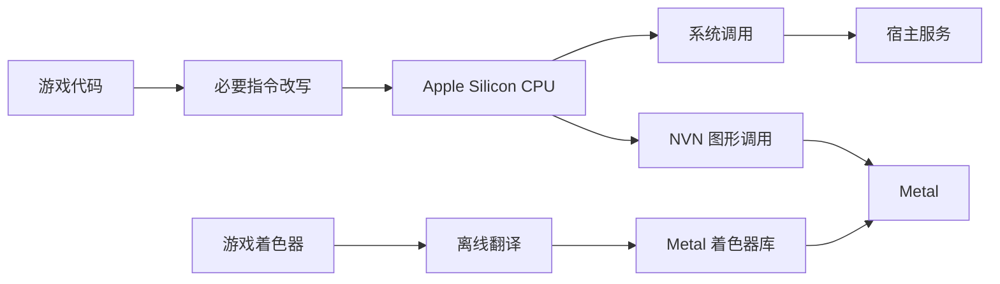

# smbw-mobile

面向 Apple 平台的《超级马力欧兄弟 惊奇》实验性适配。

本项目基于 [D2R Mobile](https://github.com/d2r-mobile/d2r-mobile) 开发，沿用其原生执行、宿主服务和 Metal 框架，补充了资源池与共享纹理回收，以及 macOS 图形和输入适配。



<details>
<summary>更多运行截图</summary>




</details>

## 说明

目前仅在 MacBook Pro（M5 Pro、48 GB 内存、macOS 27.0）上测试。项目保留了面向其他 Apple Silicon Mac 和 iPhone/iPad 的移植基础，这些设备上的运行情况尚未验证。欢迎反馈设备信息和运行结果，或通过 PR 提交改进。

## 性能




| 指标 | 实测结果 |
| --- | --- |
| 提交线程 CPU 耗时 | p50 / p95 / p99：**4.153 / 5.988 / 6.660 ms** |
| GPU 执行时长合计 | p50 / p95 / p99：**4.545 / 8.864 / 9.447 ms** |
| 进程内存 footprint | 峰值 **3094 MiB**；末值 **3023 MiB** |
| Metal 分配量 | 峰值 **1862 MiB**；末值 **1846 MiB** |
| 共享纹理缓存 | 末值 **643 MiB** |

### 优化对比



## 技术

游戏代码在 Apple Silicon CPU 上原生执行，系统调用和图形调用由宿主实现接入 Apple 平台：



- **原生执行**：仅改写平台适配所需的指令；依赖固定模块地址的处理按 NSO build ID 启用。
- **内存回收**：内存池销毁时清理存储缓存，仍被描述符使用的内容保留到最后一个槽位被覆盖或注销。描述符池按世代独立管理；纹理和缓冲按 GPU 栅栏退役，提交及驻留登记、移除产生的临时引用及时排空。
- **临时存储与页映射**：暂存空间按命令的使用期限复用，避免覆盖尚在使用的数据。游戏使用 4 KiB 页、宿主使用 16 KiB 页；解除映射时只回收完全落在解除区间内的宿主整页，保留边缘未完整覆盖的页。
- **图形适配**：渲染目标同时被采样时使用独立副本；提交命令时，对可能被提前复用的命令数据建立快照。着色器离线翻译后，由运行时加载并预热。
- **音频与输入**：通过 Apple 平台接口接入音频和输入，并处理窗口失焦时的状态变化。
- **手柄震动**：默认通过 GameController 和 Core Haptics 近似映射到手柄支持的触觉通道。可选的 [Switch 2 Pro 原生 BLE 适配](docs/ns2-pro-haptics.zh-CN.md)保留独立双频指令，已通过真实手柄探针和游戏试玩。初次反馈为更细腻但偏弱；调整后的力度和玩家灯效果仍待实机确认，绝对力度尚未与主机校准。两条路径均处理失焦、断连和退出。

## 构建与启动

需要 Apple Silicon Mac、Xcode 27、.NET 10、Python 和 SPIRV-Cross。请自行准备合法取得的游戏本体 1.0.0、更新 1.2.1 和所需密钥；仓库不分发这些文件，也不提供下载来源。按 [macOS 构建步骤](docs/build-macos.zh-CN.md) 完成提取、指令改写、着色器和宿主构建后，在仓库根目录启动：

```sh
bash scripts/run-mac.sh
```

默认工作区为仓库同级的 `smbw-mac-work/`；自定义位置可用 `SMBW_WORKSPACE` 指定。工作区内的 `run/save/` 保存存档，`run/manual.log` 保存启动日志，游戏文件、密钥和生成缓存均留在仓库外。

运行 `bash scripts/package-mac.sh` 可生成本机启动用的 `.app`。它引用工作区绝对路径，不是可独立分发的游戏包。

### 操作

支持键盘及兼容的物理手柄。键盘映射如下：

| 键盘 | 游戏输入 |
| --- | --- |
| W / A / S / D | 左摇杆 |
| 方向键 | 十字键 |
| J / K / U / I | A / B / X / Y |
| Q / E；Z / C | L / R；ZL / ZR |
| F / G | 左 / 右摇杆按下 |
| Enter / Tab | ＋ / － |

### 已知问题

- 尚未测试全部关卡；共享纹理缓存会长期增长
- 首次遇到新的渲染管线时可能因编译而卡顿，后续运行可复用缓存
- 尚未验证其他设备（iPad等）运行效果


## 许可

项目代码沿用 [MIT License](LICENSE)，保留上游版权声明；第三方组件遵循各自的许可，相关声明见 [docs/licenses](docs/licenses) 及各组件目录。游戏文件及相关商标的权利归各自权利人所有，本项目不分发游戏文件或密钥。
